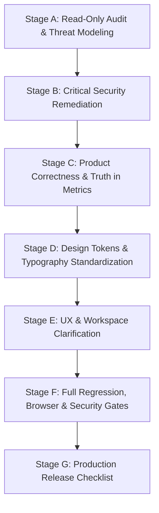

# KRIVIO AI — Master Implementation & Remediation Plan

**Plan Version:** 1.0.0  
**Target Environment:** KRIVIO AI Production & Development  
**Auditor:** Principal Software Engineer & Application Security Lead  

---

## 1. Staged Execution Strategy

Per the non-negotiable engineering principles:
- **Security & payment integrity take absolute priority over visual or UX design.**
- **Small, isolated, reversible commits.**
- **No unapproved deployments.**
- **Quality gates verified after each stage.**

---

## 2. Stage Breakdown & Dependencies

### Stage B: Critical Security & Integrity Remediation (Immediate Priority)
1. **SEC-01: Supabase Identity Verification in `/api/auth/supabase-sync`**
   - Require bearer token or `access_token` in payload.
   - Server-side validation via `supabaseServerClient.auth.getUser(token)`.
   - Prevent email-only user linking without verified Supabase identity.
   - Ignore client-provided `role` parameters.
2. **SEC-02: Payment Security & Simulated Bypass Removal**
   - Require authoritative HMAC-SHA256 signature verification with `crypto.timingSafeEqual`.
   - Fail closed if Razorpay credentials are missing (HTTP 503).
   - Strip client-side simulated payment IDs (`pay_${Date.now()}`) and simulate upgrade buttons.
3. **SEC-03: JWT Secret Hardening**
   - Validate `process.env.JWT_SECRET` presence and prevent reliance on static public fallbacks.
4. **SEC-05: CORS Policy Containment**
   - Replace arbitrary `.*\.vercel\.app` wildcard with strictly bounded project domains (`^https:\/\/krivio-ai(-[a-z0-9-]+)?\.vercel\.app$`).
5. **SEC-07: Error Disclosure Sanitization**
   - Sanitize `api/index.ts` to log stack traces on the server while returning clean, non-disclosing error codes.
6. **SEC-06: Storefront Inquiry Boundary Validation**
   - Validate `userId` existence, bound string inputs, and add anti-spam constraints.

*Exit Criteria for Stage B:* Negative security tests confirm account takeover is impossible, forged payments are rejected, and all existing 70 tests pass.

---

### Stage C: Product Correctness & Truth in Data
1. **PROD-01: Dashboard Metric Truthfulness**
   - Correct `{stats?.healthScore || 80}%` to `{stats?.healthScore ?? 0}%` in `Dashboard.tsx`.
2. **PROD-02: Marketplace Readiness Rules Rationalization**
   - Update rule labels in `MarketplaceReadiness.tsx` so phone numbers are not described as linked bank accounts.
3. **PROD-03: Marketing & Landing Page Claim Review**
   - Refine unverified claims in `LandingPage.tsx` ("100% Data Privacy", "exact COGS").

*Exit Criteria for Stage C:* Zero fabricated values or misleading proxy rules in the dashboard and readiness engine.

---

### Stage D: Design System Foundations & Accessible Typography
1. Standardize semantic color tokens (Forest Emerald, Muted Amber/Gold, Deep Charcoal, Crisp Paper).
2. Audit typography: eliminate unreadable `text-[9px]` and `text-xs` on essential labels and buttons; standardize line heights and padding for Indic scripts (Hindi, Marathi, Tamil, Bengali, Assamese).
3. Ensure WCAG 2.2 AA contrast ratios and focus ring visibility across light and dark themes.

---

### Stage E: Mobile-First UX & Workflow Clarification
1. Landing page hero clarity: Single clear primary CTA ("Start Creating Products" / "Prepare Your First Product").
2. Core user journey: Add Product → Details → Photography / Enhancement → Pricing & Review → Export.
3. Accessible destructive confirmations (replace plain `window.confirm` with styled accessible modals).

---

### Stage F: Comprehensive Verification & Quality Gates
1. Run static lint (`npm run lint`).
2. Run core security and isolation tests (`npm test`).
3. Run AI golden regression suite (`npm run test:ai`).
4. Run production build (`npm run build`).
5. Run multi-viewport browser audit (360px, 390px, 768px, 1024px, 1440px).

---

### Stage G: Release Proposal & Rollback Plan
1. Compile final `RELEASE_CHECKLIST.md` with environment requirements.
2. Formulate atomic rollback plan for database migrations or configuration changes.
3. Await explicit user authorization before production deployment.
