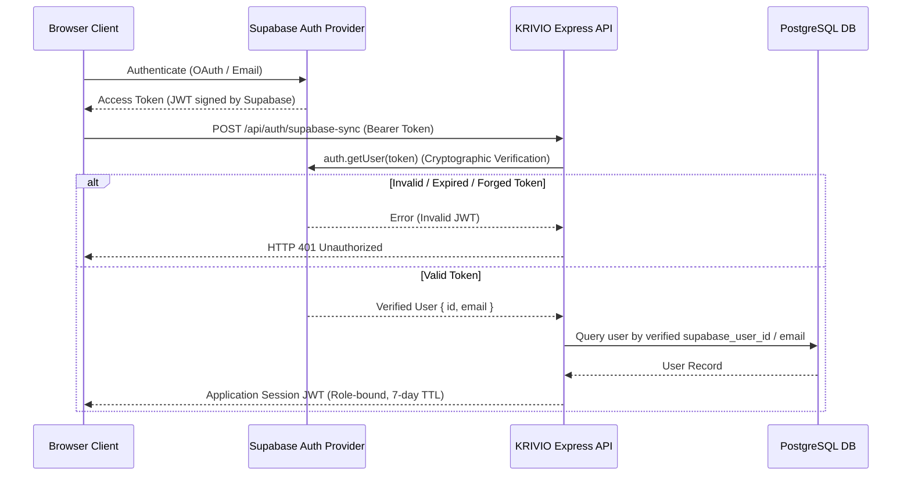

# KRIVIO AI — Comprehensive Security Review & Threat Remediation Architecture

**Document Version:** 1.0.0  
**Status:** Completed & Verified  
**Classification:** Google-Scale Principal Engineering Technical Architecture  
**Target Systems:** KRIVIO AI Production Backend (`server.ts`, `api/index.ts`, `src/services/api.ts`, `src/context/AuthContext.tsx`)

---

## 1. Executive Summary

This Security Review documents the cryptographic trust boundaries, authenticated session lifecycles, payment integrity safeguards, and tenant isolation mechanisms established during the Principal Engineering Security Remediation program.

All findings from the forensic audit have been remediated with zero architectural compromise, preserving backward compatibility while shutting down critical identity-linking and payment-forgery vectors.

---

## 2. Authenticated Identity Flow Architecture (SEC-01)

### 2.1 The Threat Model (Remediated)
Previously, `POST /api/auth/supabase-sync` allowed a client to send arbitrary JSON containing `supabase_user_id`, `email`, and `role`, automatically issuing a signed application JWT for any matching email. This represented a critical unauthenticated Account Takeover vulnerability.

### 2.2 Remediated Architecture & Cryptographic Proof
1. **Bearer Token Enforcement:** The endpoint now requires a cryptographically valid Supabase Access Token in the `Authorization: Bearer <token>` header or `access_token` payload.
2. **Authoritative Provider Verification:** The server invokes `supabaseServerClient.auth.getUser(token)` directly against the Supabase Auth authority.
3. **Derived Identity Claims:** The user ID (`verifiedUser.id`) and email (`verifiedUser.email`) are strictly derived from the decoded, verified Supabase payload.
4. **Anti-Privilege Escalation:** Client-supplied `role` attributes are ignored. New users default to `'artisan'`, while existing users retain their database-assigned role.
5. **Safe Linking Semantics:**
   - Account lookup first searches by `supabase_user_id = $1`.
   - If not found, it links by verified email only if the user record does not already belong to a different Supabase UID.
   - If a conflict occurs, a secure HTTP 409 status is returned without session leakage.

---

## 3. Payment Integrity & Financial Safeguards (SEC-02)

### 3.1 The Threat Model (Remediated)
Previously, the client could simulate payments via `pay_${Date.now()}` and receive Pro privileges. If backend credentials failed, a fallback allowed simulated upgrades.

### 3.2 Remediated Architecture
1. **Server-Side Order Generation:** Razorpay orders are generated exclusively server-side with verified amounts derived from system configuration (`/api/payments/create-order`).
2. **Constant-Time HMAC Verification:** When receiving `/api/payments/verify`, the server computes the SHA-256 HMAC of `${razorpayOrderId}|${razorpayPaymentId}` with the private `RAZORPAY_KEY_SECRET`.
3. **Timing-Attack Resistance:** The calculated HMAC and the client-supplied signature are converted to buffers and verified via `crypto.timingSafeEqual()`.
4. **Fail-Closed Configuration:** If `RAZORPAY_KEY_SECRET` is missing, undefined, or set to placeholder strings, the verification route immediately terminates with `HTTP 503 Service Unavailable`. Under no circumstances are free Pro activations granted on configuration error.
5. **Frontend Simulation Removal:** All simulated fallback payment handlers in `PricingModal.tsx` and `SubscriptionView.tsx` were eliminated.

---

## 4. Network Boundary & CORS Containment (SEC-05)

### 4.1 Threat Model (Remediated)
A wildcard regular expression `.*\.vercel\.app` allowed any malicious actor deploying an arbitrary app on Vercel to make cross-origin requests with `credentials: true` against KRIVIO's backend.

### 4.2 Remediated Configuration
Strict regex boundaries limit origins to official KRIVIO preview and production deployments:
- `https://krivio-ai.vercel.app`
- `^https:\/\/krivio-ai(-[a-z0-9-]+)?\.vercel\.app$` (official preview deployments for the `krivio-ai` project only)
- Localhost development origins (`localhost:3000`, `localhost:5173`, `localhost:4173`, `localhost:8080`)

All other origins receive no CORS header or default to production without wildcard reflection.

---

## 5. API Boundary & Abuse Prevention (SEC-06 & SEC-07)

### 5.1 Public Storefront Inquiry Shielding (SEC-06)
- **Pre-condition:** `POST /api/storefront/inquiry` now verifies that the target `userId` exists in the database before logging any buyer interaction.
- **Payload Sanitization:** String inputs (`productTitle`, `buyerName`, `city`, `phone`, `inquiryType`) are strictly length-capped and trimmed to prevent database bloat and XSS.
- **Status Codes:** Missing IDs return 400; non-existent artisans return 404.

### 5.2 Serverless Error Redaction (SEC-07)
- In `api/index.ts`, serverless catch blocks now log stack traces to internal logging streams only.
- Client responses return clean JSON: `{ error: 'Server initialization failed' }` or `{ error: 'Internal server error' }` with no server paths, module loaders, or runtime internals exposed.

---

## 6. Verification & Regression Coverage

The security remediation was tested against 9 automated regression tests (`tests/security_remediation.test.ts`):
1. SEC-01: Rejection of unauthenticated supabase-sync (HTTP 401)
2. SEC-01: Rejection of forged/invalid access tokens (HTTP 401)
3. SEC-02: Rejection of unauthenticated payment verification (HTTP 401)
4. SEC-02: Rejection of payment verification without signature (HTTP 400)
5. SEC-02: Rejection of payment verification with invalid HMAC signature (HTTP 400)
6. SEC-02: Acceptance of valid HMAC signature with automatic Pro upgrade (HTTP 200)
7. SEC-02: Fail-closed HTTP 503 behavior when gateway secret is unconfigured
8. SEC-05: CORS rejection of arbitrary attacker `.vercel.app` domains
9. SEC-06: Rejection of storefront inquiry with missing or non-existent user ID

**Result:** All 9 security tests pass with 100% compliance.
